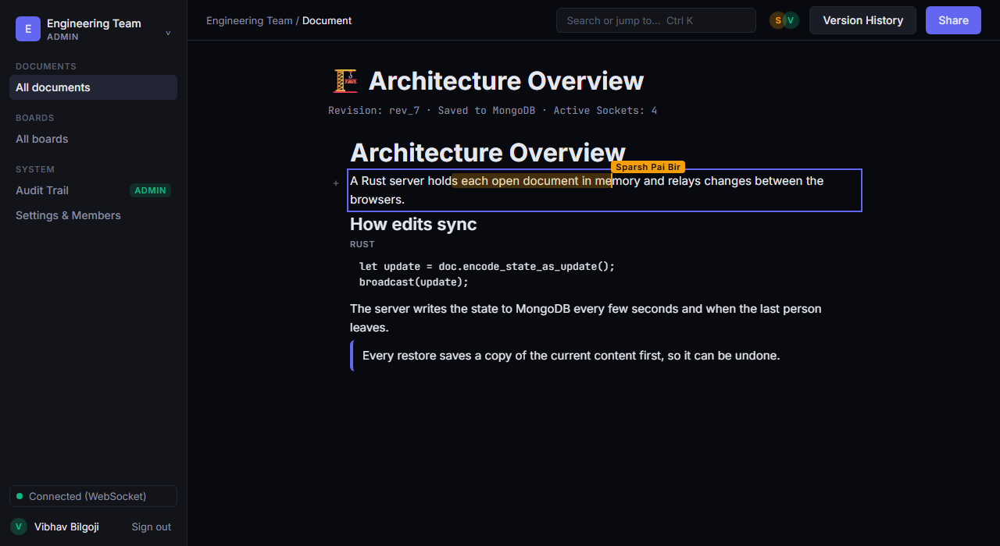
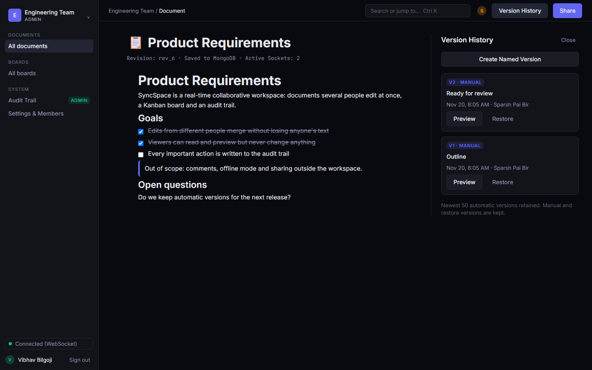
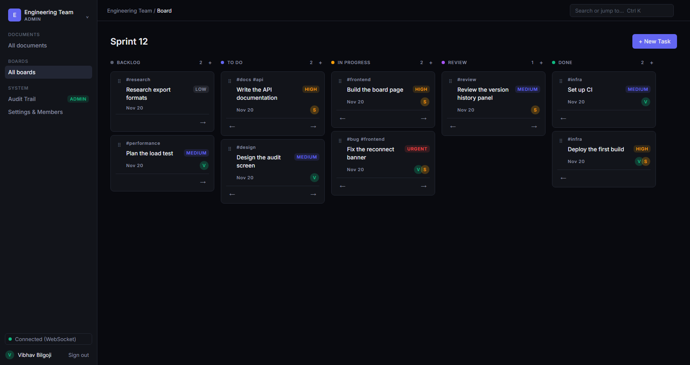
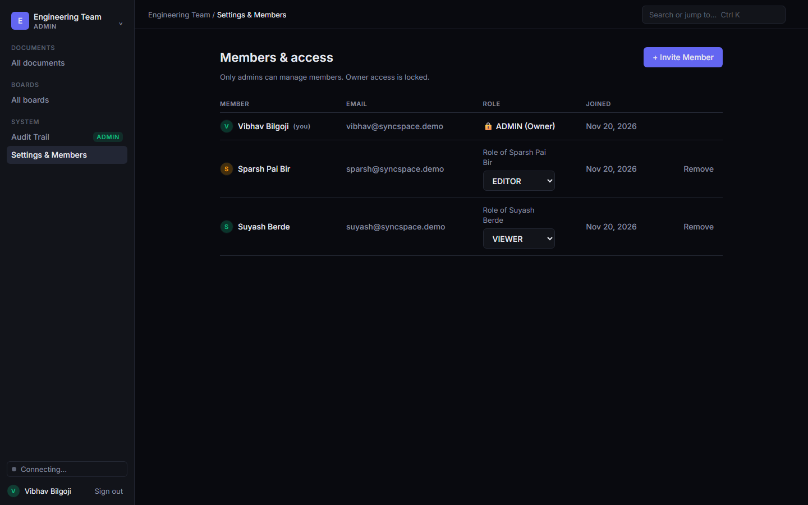
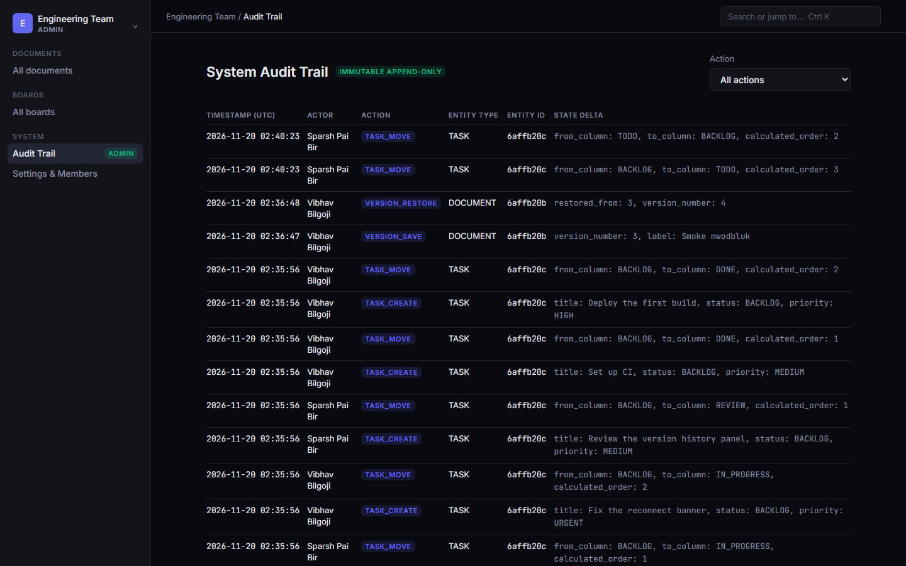
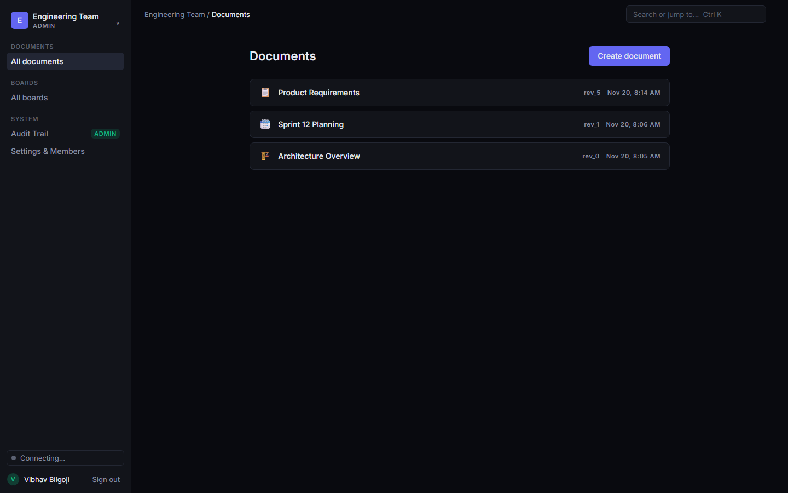
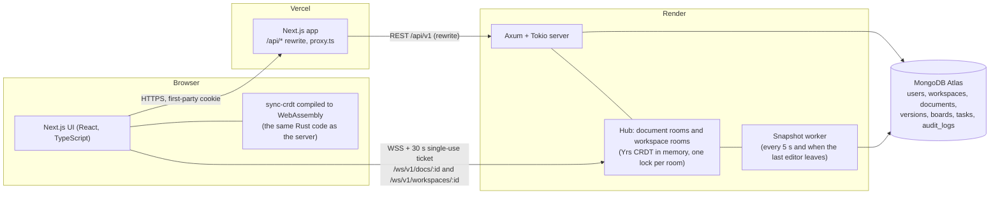

# SyncSpace

A real-time collaborative workspace: **block-based documents that several people edit at once**, **Kanban boards**, **Admin / Editor / Viewer roles**, **document version history** and an **append-only audit trail**.

A DBMS mini project by **Vibhav Bilgoji (24B-CO-076)**, **Sparsh Pai Bir (24B-CO-069)** and **Suyash Berde (24B-CO-070)**.

| | |
|---|---|
| **Live app** | https://syncspace-amber.vercel.app |
| **Live API** | https://syncspace-api-latest.onrender.com (`/healthz`) |
| **Demo script** | [`docs/DEMO.md`](docs/DEMO.md) |
| **Status and what is not built** | top of [`docs/PROGRESS.md`](docs/PROGRESS.md) |

The API runs on Render's free tier, which sleeps after 15 minutes without traffic: the first request after a pause takes about a minute.

## Screenshots

The live site, with the seeded demo data (workspace "Engineering Team").

| | |
|---|---|
|  **Live editing.** Several people in one document, presence avatars in the header, a slash menu for block types. |  **Version history.** Named versions, preview, restore (a copy of the current content is saved first, so a restore can be undone). |
|  **Kanban.** Five columns, drag and drop (pointer or keyboard), live updates in every open browser. |  **Members and roles.** The owner is locked; a role change reaches open sessions at once. |
|  **Audit trail.** Every important action, newest first, append-only, filterable. |  **Documents.** Seeded documents with their revisions. |

## Features

- **Live editing of block documents.** Six block types (paragraph, two headings, checklist, code, callout), a slash menu, remote edits that keep your caret, presence avatars and an "Active Sockets" counter. Edits merge without losing anyone's text, also after a dropped connection (the browser keeps its edits and merges them when it reconnects).
- **Roles enforced by the server.** Admin, Editor and Viewer. Every REST route and every WebSocket frame checks the caller's role; the UI only hides what would be refused. A role change or a removal closes that person's open sockets at once.
- **Version history.** Save a named version, preview it read-only, restore it for everybody (live), and undo a restore.
- **Kanban boards.** Five fixed columns, tasks with priority, tags and assignees, drag and drop with pointer **and keyboard**, arrow buttons and a status dropdown as the fallback, and live updates through a workspace socket.
- **Members screen.** Add a registered account, change a role (with a confirmation), remove a member; the owner cannot be changed.
- **Audit trail.** Ten audited actions (members, documents, versions, tasks), written by the server in the same code path as the action, never updated or deleted; an Admin reads them in a table with an action filter.
- **Search and command palette.** The header search field, or Ctrl/Cmd + K, finds documents, boards, Settings & Members and (for admins) the Audit Trail; arrow keys, Enter and Esc.
- **Reconnect and connection state.** Backoff with jitter, a banner and a connection pill.

Not built (kept in [`docs/PROGRESS.md`](docs/PROGRESS.md) with the reasons): remote cursors and selections, automatic versions (ADR-012), the Assignee and Priority filters in the board UI, the JSON inspector and export of the audit screen, the general settings tab, `DOC_LIST_EVENT` and `MEMBER_EVENT`, several server nodes with Redis.

## Architecture



- **One CRDT, two builds.** [`crates/sync-crdt`](crates/sync-crdt) (Yrs, pinned to one version) is compiled natively for the server and to WebAssembly for the browser, and a parity test checks that both produce byte-identical results. The server validates every incoming update before it relays it (a hostile update must never panic the process).
- **REST for state, WebSocket for live changes.** REST goes through the web domain so the session cookie is first-party; WebSockets go straight to the API with a short-lived ticket. A document socket carries the y-sync protocol; a workspace socket carries `BOARD_EVENT`.
- **MongoDB.** The CRDT snapshot is the source of truth for a document's content; its block projection is kept next to it for lists and previews. Versions are zstd-compressed snapshots; audit rows are append-only.
- Details: [`docs/ARCHITECTURE.md`](docs/ARCHITECTURE.md), [`docs/DATA_MODEL.md`](docs/DATA_MODEL.md), [`docs/API.md`](docs/API.md), [`docs/DECISIONS.md`](docs/DECISIONS.md).

## Tech stack

| Layer | Technology |
|---|---|
| Server | Rust 1.100, Axum 0.8, Tokio, `mongodb` driver 3.10, argon2id, HS256 JWT in an HttpOnly cookie |
| CRDT | Yrs 0.28.1 (native and `wasm32-unknown-unknown`), `wasm-pack` |
| Database | MongoDB 8.0 (Atlas free cluster in production) |
| Web | Next.js 16 (App Router, Cache Components), React 19, TypeScript (strict), Tailwind CSS 4, dnd-kit |
| Tests | cargo test (unit, integration against a real MongoDB, property tests), `wasm-pack test`, Vitest and Testing Library, Playwright (Chromium and Firefox) |
| Delivery | GitHub Actions, Docker (distroless image on GHCR), Render, Vercel, MongoDB Atlas |

## Repository layout

```
crates/sync-crdt/   shared Yrs logic, built natively and to Wasm
crates/server/      Axum API, WebSocket hub, snapshot worker, seed script
apps/web/           Next.js app
e2e/                Playwright end-to-end tests
infrastructure/     docker-compose for a local MongoDB
docs/               PRD, architecture, data model, API, UI spec, testing, roadmap, decisions, deployment, progress, demo
```

## Run it locally

Prerequisites: Rust (rustup; `rust-toolchain.toml` pins 1.100.0 and the Wasm target), Node 22 or newer with pnpm, `wasm-pack` (`cargo install wasm-pack --locked`) and **MongoDB 8.0** on `localhost:27017` (the version Atlas runs; Docker works: `docker compose -f infrastructure/docker-compose.yml up -d mongo`).

```bash
cp .env.example .env            # fill JWT_SECRET and TICKET_SECRET (two different base64 values of 32+ bytes)
cargo run -p server             # API on http://localhost:8080 (GET /healthz)

pnpm --dir apps/web install
pnpm --dir apps/web wasm        # builds the browser CRDT package, once and whenever sync-crdt changes
pnpm --dir apps/web dev         # web on http://localhost:3000

# optional: demo data (a workspace, three accounts, documents, a board)
cargo run -p server --bin seed -- --workspace "Engineering Team"   # prints a random demo password once
```

## Tests

| What | Command | Result on `main` |
|---|---|---|
| Rust: unit, integration (real MongoDB), property tests | `cargo test --workspace` | 449 passed, 0 failed (3 more are ignored fixture generators) |
| Native and Wasm parity | `wasm-pack test --node crates/sync-crdt` | passing |
| Rust lint | `cargo fmt --all --check && cargo clippy --workspace --all-targets -- -D warnings` | clean |
| Web unit and component tests | `pnpm --dir apps/web test` | 356 tests in 30 files, all passing |
| Web lint, format and types | `pnpm --dir apps/web lint && pnpm --dir apps/web typecheck` | clean |
| End to end (real API and MongoDB, Chromium and Firefox) | `pnpm --dir e2e install && pnpm --dir e2e exec playwright install chromium firefox && pnpm --dir e2e test` | 18 runs in 6 spec files, all passing |
| Coverage gates (blocking in CI) | `cargo llvm-cov -p sync-crdt --fail-under-lines 90` and `cargo llvm-cov -p server --fail-under-lines 75` | both gates pass in CI |

CI (`.github/workflows/ci.yml`) runs all of this on every pull request and on every push to `main`. Every protection added to the code was disabled in turn to check that a test fails (the log of that is in [`docs/PROGRESS.md`](docs/PROGRESS.md)). The strategy is in [`docs/TESTING.md`](docs/TESTING.md).

## Deployment

Web on Vercel (a remote build of `apps/web`), API as a distroless Docker image built by GitHub Actions and run on Render, database on MongoDB Atlas. Steps and environment variables: [`docs/DEPLOYMENT.md`](docs/DEPLOYMENT.md).

## Documentation

[`docs/PRD.md`](docs/PRD.md) (requirements) · [`ARCHITECTURE.md`](docs/ARCHITECTURE.md) · [`DATA_MODEL.md`](docs/DATA_MODEL.md) · [`API.md`](docs/API.md) · [`UI_SPEC.md`](docs/UI_SPEC.md) · [`TESTING.md`](docs/TESTING.md) · [`ROADMAP.md`](docs/ROADMAP.md) · [`DECISIONS.md`](docs/DECISIONS.md) · [`DEPLOYMENT.md`](docs/DEPLOYMENT.md) · [`PROGRESS.md`](docs/PROGRESS.md) · [`DEMO.md`](docs/DEMO.md)

## Team

| Name | Roll number |
|---|---|
| Vibhav Bilgoji | 24B-CO-076 |
| Sparsh Pai Bir | 24B-CO-069 |
| Suyash Berde | 24B-CO-070 |

It was built task by task with Claude Code following [`docs/ROADMAP.md`](docs/ROADMAP.md); `MASTER_PROMPT.md` holds the prompts used to start each phase.
