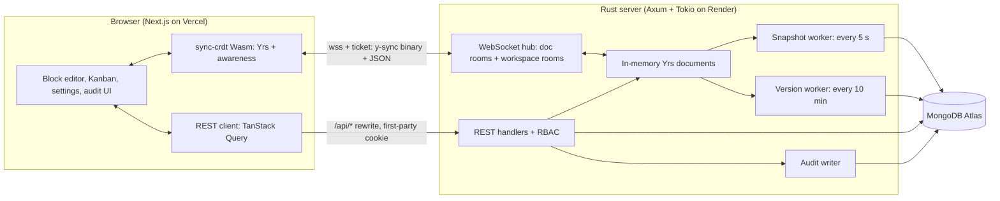
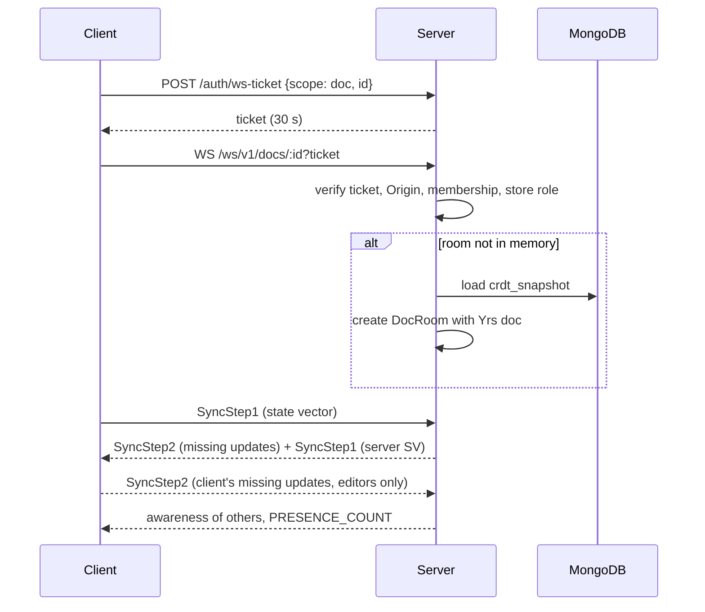
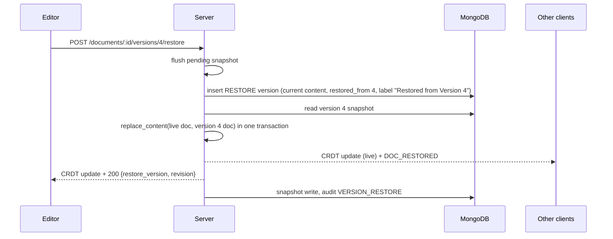

# Architecture (v5)

## 1. System overview

One Rust node holds every open document in memory and broadcasts updates to everyone connected. MongoDB stores throttled snapshots, versions, and all other data. Redis is only needed for the optional multi-node phase.

## 2. Components

### crates/sync-crdt
One crate, two targets: native (used by the server) and `wasm32-unknown-unknown` with `wasm-bindgen` (used by the browser). It owns everything that touches the Y.Doc so both sides behave identically.

| Module | Responsibility |
|---|---|
| `schema` | block map layout (`DATA_MODEL.md` §6), the six block types, id, order and property rules, the limits, `order_between` |
| `ops` | `create_block`, `delete_block`, `insert_text`, `delete_text`, `set_type`, `set_props`, `move_block` (fractional order), `renumber`; every argument is checked before a transaction opens, so a failing edit changes nothing |
| `projection` | `blocks(doc) -> Vec<Block>` sorted by `(order, block_id)`, `blocks_json()`; used for `documents.blocks`, previews, tests. Shows only the properties that belong to a block's type |
| `restore` | `replace_content(live, target)`: one transaction that makes the live doc's blocks equal the target's (delete missing, add new, rewrite changed text, set type, props, order) |
| `sync` | `handle_message(frame)` over `yrs::sync::Message` (SyncStep1 gets a SyncStep2 reply; SyncStep2 and Update go through the guarded apply and come back for broadcast; awareness is passed through for task 3.1), `sync_step1_frame`, `update_frame` |
| `validate` | decode an update without panicking, size limit, the scratch-replica rehearsal, and the structure check of a block document (only the roots `blocks` and `meta`, at most 2000 blocks, valid ids, types, finite orders, text within 100 000 UTF-16 units, known properties with valid values). A block document also refuses an update that builds on changes it does not have: `CrdtError::MissingDependencies` |
| `wasm` (cfg target wasm32) | `#[wasm_bindgen]` API. `WasmDocument` (task 2.1): `new(clientId)`, `createBlock(id, type, order, content)`, `deleteBlock`, `insertText(id, index, chunk)`, `deleteText(id, index, len)`, `setType`, `setProps(id, json)`, `moveBlock`, `renumber()`, `blockContent`, `blocksJson()`, `stateVector()`, `encodeStateAsUpdate()`, `encodeStateAsUpdateFrom(sv)`, `applyUpdate`, `syncStep1Frame()`, `handleMessage(frame)` (returns the reply frame, empty when none), plus `orderBetween(before?, after?)` and `updateFrame(update)`. Edits return the update bytes. Awareness and sticky-index helpers arrive with task 3.1. `WasmDoc` is the 0.3 spike, removed with the spike |

### crates/server
| Module | Responsibility |
|---|---|
| `config` | env vars (`DEPLOYMENT.md` §5), fail fast if missing |
| `db` | Mongo client, typed collections, index creation, repositories per collection |
| `auth` | argon2id on blocking threads (at most 4 at a time, section 5), JWT session cookie, `AuthUser` extractor, ws tickets (HMAC, 30 s, single use via in-memory set), `Origin` check |
| `rbac` | `require_role(workspace, user, min_role)`; one place for the permission matrix: a non-member gets 404, a member with too low a role 403. The router under `/api/v1` is built from `app::api_route_table()` (method, path, access, handler per route), which `tests/rbac_matrix.rs` walks and compares with `API.md` |
| `api` | Axum routers per resource; request validation; maps errors to the error format |
| `hub` | `Hub` (rooms by document id, loaded from the snapshot once even when two connections arrive together, ticket store), `DocRoom` (the CRDT replica behind a `std` mutex that is never held across an `.await`, a broadcast channel, the open-socket count, the dirty flag), `socket` (Origin and ticket checks, the role of the user, per-frame role checks, rate limits, size limits, close codes), `limits` (token buckets), `frames` (the JSON text frames). The `WorkspaceRoom` arrives with the board (task 5.x). The role is read when a socket connects; a role change or removal closes the user's sockets so the reconnect applies it (ADR-014) |
| `snapshot` | 5 s worker and final flush |
| `versions` | 10 min automatic versions, manual save, restore, retention |
| `audit` | `audit::record(...)`; the only writer to `audit_logs` |
| `rate_limit` | token buckets per connection |
| `metrics` | counters: edits/s, Mongo writes/s, broadcast latency; exposed at `/metrics` (text) |

### apps/web
Next.js App Router, TypeScript strict, Tailwind CSS with the tokens from `UI_SPEC.md`, TanStack Query for REST, dnd-kit for the board, cmdk for the command palette, the Wasm package for documents. Pages and components are listed in `UI_SPEC.md`.

## 3. Key flows

### 3.1 Open a document

### 3.2 Edit
1. The client computes the minimal change in a block (common prefix and suffix) and calls the Wasm op.
2. The Wasm observer emits an update; the client sends it.
3. The server checks role and rate limit, validates and applies it to the room doc, broadcasts it to the other connections, sets `dirty = true` and `changed_since_version = true`, and increments the edits metric.

### 3.3 Snapshot (every 5 s)
For each dirty room: swap `dirty` to false **before** encoding; encode state and build the projection while holding the doc only for that; release; write `crdt_snapshot`, `blocks`, `updated_at`, `revision + 1`, `changed_since_version = true`; on failure set `dirty` back to true. Broadcast `SNAPSHOT_SAVED {revision}`. When the last client leaves or on SIGTERM, flush immediately before dropping the room.

### 3.4 Automatic version (every 10 min)
**Deferred: this flow is future work and is not built for the submission (ADR-012, task 4.2).** It stays here as the design.

For each room whose content changed since the last version (`changed_since_version`) and whose newest version is at least 10 minutes old: write an AUTOMATIC version (compressed snapshot, `created_by = null`, label "Periodic Snapshot"), clear the flag, prune AUTOMATIC versions beyond the newest 50, broadcast `VERSION_CREATED`. Also run once when the last editor leaves if the flag is set. Not audited.

### 3.5 Manual version
`POST /documents/:id/versions {label}`: flush a snapshot first if dirty, then store the snapshot as a MANUAL version with `created_by`, audit VERSION_SAVE, broadcast `VERSION_CREATED`.

### 3.6 Restore

The restore is a normal CRDT edit, so history is never rewritten and edits that other people make at the same moment merge with it. If the room is not in memory, load it first.

### 3.7 Move a task
`PATCH /tasks/:id/move` computes `order` on the server (`API.md`), updates the task, writes audit TASK_MOVE, and broadcasts `BOARD_EVENT TASK_MOVED` on the workspace room. Card moves are last-write-wins per card. The client moves the card optimistically and rolls back on error.

### 3.8 Role change or removal
The members handler updates MongoDB, writes the audit row, then tells the hub. The hub updates the role stored in each of that user's live sessions in the workspace (doc and workspace rooms) and sends `ROLE_CHANGED`. Removal closes those sessions with 4003. A downgraded editor's next update is rejected with `READ_ONLY`.

### 3.9 Session expiry
JWT expiry closes sockets with 4001 at the next frame or ping. The client keeps its Y.Doc in memory (unsent edits included), shows frame 41, and after login gets a new ticket and repeats the handshake, which merges the pending edits.

## 4. Concurrency rules

- Each `DocRoom` holds `Arc<Mutex<Doc>>` (or a single-task actor). Never hold the guard across `.await`. Prefer an actor per room (`mpsc` channel) if lock contention shows up in the load test.
- Broadcast with `tokio::sync::broadcast` per room; slow consumers that lag are disconnected with 1008 and reconnect.
- `version_number` allocation uses `findOneAndUpdate($inc next_version)`.
- A restore and a snapshot in the same room are serialised through the room.
- Ticket single-use set is pruned every minute.
- Every socket send has a timeout (5 to 10 s) and every connection an idle deadline. A peer that stops reading would otherwise block its task inside `send`: the task could not reach the lag check, and the broadcast backlog (messages are kept until the slowest receiver reads them) would never be freed. On timeout, drop the connection without waiting for the peer. (Found in the task 0.3 review; implemented and tested in the spike relay as `send_within` and its ping loop, `crates/server/src/spike.rs`. Keep both when the hub replaces it.)
- Treat every decoded update as hostile. Decode inside `catch_unwind`, reject anything that does not survive an encode and decode round trip, and **rehearse the update on a scratch replica of the room (apply, then encode) before applying it to the live document**: Yrs 0.28.1 can panic while integrating a crafted update (an unchecked `u32` subtraction at `block_store.rs:320`), and a panic mid-transaction would leave the room half applied. Never let a panic in Yrs reach a task holding a room lock. Build with `overflow-checks = true` for `yrs` in release (`[profile.release.package.yrs]` in `Cargo.toml`), because without it the same input wraps silently and is accepted, and refuse `panic = "abort"` on native targets (`sync-crdt` has a compile-time guard), because `catch_unwind` only works when panics unwind. Details and the upstream report: `docs/PROGRESS.md`.
- **Updates must arrive in causal order, and the hub re-syncs instead of closing when they do not.** `Document::apply_update` returns `MissingDependencies` for an update that builds on changes the server lacks (Yrs would park it in a pending queue, which is where its panics and a data-losing re-encode live: see `PROGRESS.md`). That is not a protocol violation: the hub answers with its own SyncStep1 so the client sends the diff, and keeps the socket. Every other error from `apply_update` and `handle_message` is a violation and closes with 1008.
- **The Wasm client cannot catch panics.** A panic aborts the Wasm instance, so a browser must never be handed an update the server has not already accepted. The server therefore validates (decode, round trip, rehearsal) and applies an update *before* broadcasting it, broadcasts only after success, and builds the state frame for a joining client from its own validated document, never by relaying raw bytes it has not applied. If the server relays an unchecked update, one hostile peer can crash every open tab.
- **Cost of the rehearsal and the shadow-document alternative.** The rehearsal copies the room state (encode, decode, apply, encode) once per update, so its cost grows with document size. The alternative is a persistent **shadow replica** per room: apply each update to the shadow first inside `catch_unwind`, then to the live document if that succeeded, and rebuild the shadow from the live document after a panic (so the extra work happens only under attack). It removes the per-update copy but doubles the memory per room. Decide between the two with the Phase 2 load test (edits/s and CPU at the expected document sizes), and prefer an upstream fix or a pinned patch if one exists.
- The rehearsal runs under the room lock, because it has to see exactly the state the real apply will see. The lock is never held across an `.await` (CLAUDE.md rule 4). An optimistic variant (rehearse on a snapshot, re-check a version counter under the lock, retry on change) is possible if lock hold time shows up in the load test.

## 5. Security

argon2id (memory 19 MiB, 2 iterations, parallelism 1, the OWASP baseline); JWT HS256 with a 32-byte secret; cookie `HttpOnly; Secure; SameSite=Lax`; CORS only for `ALLOWED_ORIGINS`; WebSocket `Origin` check; 1 MiB frame cap; per-connection token buckets; request body limit 256 KiB on REST; generic login error; uniform 404 for resources outside the caller's workspaces; no stack traces in responses; `tracing` logs without passwords, tokens or tickets. Each password hash needs 19 MiB and Render's free instance has 512 MB, so hashing runs on blocking threads behind a limit of 4 at a time (about 76 MiB); a request that cannot get its turn within 5 s gets 429. Without the limit a few dozen parallel logins, or one attacker, would exhaust the memory. A login for an unknown email verifies a dummy hash so it takes as long as one for a wrong password. Session tokens are verified with HS256 only and no clock leeway.

## 6. Failure modes

| Scenario | Behaviour |
|---|---|
| Client disconnects | Edits stay in the local Wasm doc; the reconnect handshake merges both sides; banner frame 13 |
| Server restarts | Clients reconnect with backoff; the room reloads from the last snapshot; clients resend newer updates |
| Last client leaves | Final snapshot and, if changed, an automatic version, then the room is dropped |
| MongoDB write fails | Dirty flag restored; retried next tick; `/healthz` reports degraded after 3 failures |
| Render free instance asleep | First request wakes it (about 1 minute); the web app shows "Waking up the server" while `/healthz` is pending |

## 7. Optional phase: several nodes with Redis
Put broadcast behind a `Bus` trait with an in-memory version (default) and a Redis version. Channels `doc:{id}` and `workspace:{id}`; messages carry `node_id` and a node ignores its own. A node that subscribes announces its state vector and peers answer with the missing diff. Snapshot writes merge first and use a conditional write on `revision`. Demo with docker compose: two nodes, Redis, MongoDB and a reverse proxy.
